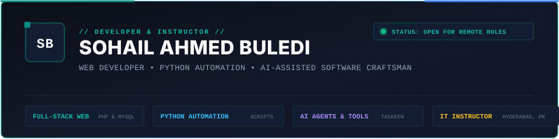

<p align="center">
  
</p>

<p align="center">
  <a href="https://suhailahmed-dev.github.io/portfolio/"></a>
  <a href="https://wa.me/923093174020"></a>
  <a href="mailto:sohailbuledi84@gmail.com"></a>
  <a href="https://suhailahmed-dev.github.io/portfolio/#projects"></a>
</p>

<p align="center">
  
  
  
</p>

---

### ⚡ Executive Profile Overview

I am **Sohail Ahmed Buledi**, a **Systems Architect, Algorithmic Trading Developer, and IT Instructor** based in Hyderabad, Pakistan.

I engineer resilient, database-backed web architectures, high-performance automated trading systems, and autonomous multi-agent AI platforms. My engineering mindset bridges strict classical software fundamentals (**PHP 8+, normalized relational database schemas, defensive API design, and MVC/OOP patterns**) with modern distributed automation (**Python AsyncIO, Playwright, algorithmic telemetry, and LLM tool-calling orchestration**).

* 🚂 **Interactive Portfolio:** Experience my live, train-themed portfolio showcasing rolling project carriages, real-time audio telemetry, and deep cargo inspection at [suhailahmed-dev.github.io/portfolio](https://suhailahmed-dev.github.io/portfolio/).
* 📈 **Quantitative & Algorithmic Track Record:** Designed execution bots verified against real live forward tests (**75.0% Win Rate**, 1% strict equity risk cap) and extensive multi-pair soak test telemetry (**14,323 executed database orders** across 500+ hours).
* 🤖 **Multi-Agent Orchestration:** Architect of autonomous AI command centers coordinating up to 15 specialized prompt agent roles with zero hallucinations and strict permission gates.
* 👨‍🏫 **Technical Leadership & Mentorship:** Lead Web Development Instructor at an IT institute in Hyderabad, guiding hundreds of engineers from core computer science primitives to full-stack production deployments.

---

### 📊 Quantified Engineering Telemetry

<div align="center">

| Metric | Verified Telemetry Value | Target Domain / Architecture |
| :--- | :---: | :--- |
| **Forward Test Win Rate** | **`75.0%`** *(18 Wins / 6 Losses)* | ZainForexAutoBot (Gold High-Frequency Execution) |
| **Executed Database Orders** | **`14,323 Orders`** | Sophi Quant Multi-Pair Engine (`trading_bot.db`) |
| **Simulated Bot Volume** | **`$6,164,188 USD`** | Multi-Pair High-Volume Stress Soak Test |
| **Coordinated Agent Roles** | **`15 Specialized Agents`** | APEX Marketing AI Multi-Role Command Center |
| **Continuous Soak Test** | **`500+ Uptime Hours`** *(22 Days)* | Uninterrupted Async Order Matching Engine |
| **Engineers Mentored** | **`100+ Students`** | IT Institute Web & Database Curriculums |

</div>

---

### 🏆 Featured Production Systems & Codebases

#### 1. 📈 Algorithmic Trading & Quantitative Engines

* **[ZainForexAutoBot — High-Frequency Gold Execution Engine](https://suhailahmed-dev.github.io/portfolio/#projects)**
  * **Architecture:** Algorithmic trading system built for precision momentum breakouts on precious metals with automated position sizing and capital protection.
  * **Verified Track Record:** 
    * **75.0% Win Rate** verified on real forward testing (18 Wins, 6 Losses across 24 trades).
    * **1m 42s** average trade hold duration (ultra-fast scalp execution).
    * Strict **1.0% equity cap** stop-loss protocol preventing account drawdown.
    * Real-time automated profit-trailing stops and slippage protection.
  * **Stack:** `Python 3` • `MetaTrader 5 API` • `AsyncIO` • `Statistical Risk Models`

* **[Sophi — Quantitative Multi-Pair Arbitrage & Grid Engine](https://suhailahmed-dev.github.io/portfolio/#projects)**
  * **Architecture:** Asynchronous multi-currency algorithmic engine running simultaneous grid, mean-reversion, and triangular arbitrage strategies across 8 major currency pairs.
  * **Verified Database Metrics:** 
    * **14,323 executed orders** recorded in local SQLite audit trail.
    * **2,014 matched win fills** vs **4,776 hedged/exit fills**.
    * **$6.16M simulated transaction turnover**.
    * **22-day continuous soak test** with zero memory leaks or unhandled thread crashes.
  * **Stack:** `Python 3` • `SQLite Telemetry` • `Multi-Threading` • `Dynamic Risk Shifters`

---

#### 2. 🤖 Autonomous AI & Multi-Agent Systems

* **[APEX Marketing AI Command Center](https://github.com/suhailahmed-dev/APEX-Marketing-AI-CommandCenter)**
  * **Architecture:** Enterprise multi-agent content generation and marketing intelligence engine orchestrating 15 specialized prompt agent personas (Strategy, Copywriting, SEO, Analytics, Viral Hooks).
  * **Capabilities:** Eliminates generic AI output by routing prompts through a multi-pass refinement pipeline, generating 30-day cross-channel roadmaps, high-converting hooks, and data-backed ad variations.
  * **Stack:** `Python 3` • `Google Gemini API` • `Streamlit` • `SQLite` • `Prompt Chaining`

* **[Zain AI Enterprise Commander](https://github.com/suhailahmed-dev/Zain-AI-Enterprise-Commander)**
  * **Architecture:** Centralized enterprise operations mission control room featuring an asynchronous WebSocket event bus and neural voice dispatch.
  * **Capabilities:** Real-time department telemetry streaming, automated server health monitors, and low-latency voice synthesis for instant executive notifications.
  * **Stack:** `Python 3` • `WebSockets` • `Edge-TTS Neural Audio` • `AsyncIO`

---

#### 3. ⚙️ Scalable Automation & Web Platforms

* **[Faceless Video Autopilot](https://github.com/suhailahmed-dev/Faceless-Video-Autopilot)**
  * **Architecture:** Zero-touch headless media production factory that automatically generates, voice-synthesizes, renders, and publishes short-form vertical video content.
  * **Capabilities:** Viral retention scripting, 24kHz neural speech synthesis (English, Urdu, Roman Urdu), dynamic FFmpeg kinetic subtitle burning, and automated browser uploads.
  * **Stack:** `Python 3` • `FFmpeg Engine` • `Playwright Headless` • `Edge-TTS` • `AsyncIO`

* **[SiteSeller — Autonomous Lead Discovery & Outreach Engine](https://github.com/suhailahmed-dev/SiteSeller-Lead-Engine)**
  * **Architecture:** High-converting client acquisition bot that crawls Google Places for businesses lacking web presence and dynamically generates instant tailored website prototypes.
  * **Capabilities:** Geo-spatial POI querying, automated domain audits, instant single-page site generator, and personalized WhatsApp conversion message generator.
  * **Stack:** `Node.js` • `Express` • `Google Places API` • `Tailwind CSS` • `Cloudflare`

* **[Secure Intelligent Online Assessment System](https://suhailahmed-dev.github.io/portfolio/#projects)**
  * **Architecture:** Institutional testing and skill examination platform equipped with client-side anti-cheating tab-switch detection and automated grading.
  * **Capabilities:** Automatic tab violation logging, auto-submit countdown timers, difficulty blueprint weighting, and instant institutional report generation.
  * **Stack:** `PHP 8 (OOP/MVC)` • `MySQL (Strict Relational 3NF)` • `JavaScript ES6` • `AJAX` • `Bootstrap 5`

---

### 🛠️ Comprehensive Technical Competency Matrix

| Architectural Domain | Technologies & Core Proficiencies |
| :--- | :--- |
| **Backend & Web Systems** | **PHP 8+** (OOP, MVC Principles, Clean Architecture), **Node.js** (Express), **Python** (FastAPI, AsyncIO), RESTful API Design, Apache `.htaccess` URL Rewriting, Session Security & CSRF Defense |
| **Database Engineering** | **MySQL & MariaDB**, 3rd Normal Form (3NF) Normalization, Foreign Key Integrity, Composite Indexes, ACID Transactions, Query Optimization, **SQLite** Local Telemetry Stores |
| **Algorithmic Trading & Finance** | Automated Order Execution, Momentum Breakout Logic, Position Sizing, 1% Strict Capital Protection, Slippage Mitigation, MT5 Interop, Quantitative Telemetry |
| **AI Agents & LLM Tooling** | Multi-Agent Orchestration (APEX 15 Roles), Structured JSON Function Calling, Prompt Chaining, Google Gemini API, Local LLM Integration, Vibe Coding Governance |
| **Browser Automation & Scraping** | **Playwright** Headless Automation, **Selenium**, Web Scraping (BeautifulSoup, Requests), Headless Session Emulation, CAPTCHA Handling, Bot Evasion |
| **Media & Audio Engineering** | **FFmpeg** Kinetic Subtitle Burning, 24kHz Neural Text-to-Speech (Edge-TTS), Web Audio API Synthesis, Video Transcoding & Packaging Pipelines |
| **DevOps & Developer Tools** | **Git & GitHub**, GitHub Pages Deployment, XAMPP, Postman API Testing, Composer, NPM, Linux / Windows Terminal Scripting, VS Code |

---

### 📈 GitHub Real-Time Engineering Activity

<div align="center">
  
  
</div>

<p align="center">
  
</p>

---

### 🧬 Architectural Blueprint & Verification Workflow

```
[ Problem Definition & Real-World Constraints ]
                     │
                     ▼
[ Relational Schema Design & Normalization ]  ──> Strict Foreign Keys, ACID Transactions
                     │
                     ▼
[ Resilient Implementation & Defensive Logic ] ──> Input Sanitation, Auth Guards, Rate Limiting
                     │
                     ▼
[ Algorithmic Telemetry & Stress Soak Testing ] ──> 500+ Hours Soak Test, Real Forward Telemetry
                     │
                     ▼
[ Continuous Deployment & Documentation ]      ──> GitHub Pages, Clean Migrations, Full Specs
```

1. **Database & Primitives First:** Never build on shaky schemas. I design normalized relational models with strict constraints before writing a single controller.
2. **Deterministic Risk Protection:** Every automated execution engine (Forex, Quant, Scraping) has strict hard limits (1% risk cap, rate limiters, fallback handlers).
3. **Verified Code Over Hype:** I showcase systems verified against real data: real win rates, real database order counts, and running client tools.

---

### 💼 Professional Experience & Teaching

* 👨‍🏫 **Web Development & Software Instructor** • *IT Institute, Hyderabad, Pakistan*
  * Train cohorts of aspiring software engineers in full-stack web development: HTML5, CSS3, JavaScript, PHP, MySQL, and modern tooling.
  * Formulate hands-on curriculum centered on building real database systems, exam portals, e-commerce prototypes, and Git version control workflows.
  * Guide students on defensive coding, SQL injection prevention, clean database design, and algorithmic thinking.

* 🌐 **Freelance Systems Architect & Automation Consultant**
  * Provide specialized backend development, quantitative bot development, and programmatic workflow automation for global clients.
  * Deliver custom institutional portals, lead generation crawlers, and automated video generation engines.

---

### 📬 Direct Executive Contact & Channels

I am open to **Senior Remote Roles**, **Contract Backend Engineering**, **Algorithmic Trading System Development**, and **High-Impact International Projects**.

* 🌐 **Interactive Portfolio:** [suhailahmed-dev.github.io/portfolio](https://suhailahmed-dev.github.io/portfolio/)
* 💬 **WhatsApp Direct:** [+92 309 3174020](https://wa.me/923093174020?text=Hello%20Sohail,%20I%20reviewed%20your%20GitHub%20profile%20and%20would%20like%20to%20discuss%20a%20development%20opportunity)
* ✉️ **Executive Email:** [sohailbuledi84@gmail.com](mailto:sohailbuledi84@gmail.com)
* 📍 **Base:** Hyderabad, Sindh, Pakistan *(Aligned with UK / European / US-East timezones)*

<p align="center">
  <sub>⚡ Engineered with precision, verified against live data • © Sohail Ahmed Buledi</sub>
</p>
